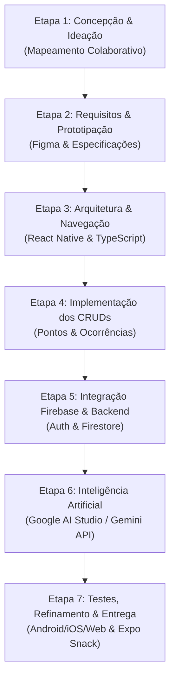

# 🚀 AcessiMap Fortaleza — Etapas do Projeto

> **Disciplina:** T197 – Desenvolvimento para Plataforma Móvel  
> **Instituição:** Universidade de Fortaleza (UNIFOR)  
> **Professora:** Lyndainês Santos  
> **Integrante:** Raylson Soares de Oliveira — Matrícula: 2512902  

---

## 📋 Visão Geral das Etapas

O projeto **AcessiMap Fortaleza** é um aplicativo móvel colaborativo voltado ao mapeamento e monitoramento da acessibilidade urbana na cidade de Fortaleza - CE. Abaixo está o cronograma e detalhamento de todas as etapas do ciclo de desenvolvimento, desde a concepção até a entrega final.

---

## 📌 Detalhamento das Etapas

### 🔹 Etapa 1 — Concepção da Ideia e Mapeamento Colaborativo
- **Status:** `[Concluído]` ✅
- **Objetivo:** Identificar o problema de mobilidade urbana em Fortaleza para pessoas com deficiência motora/visual, idosos, gestantes e pessoas com mobilidade reduzida.
- **Entregáveis:**
  - Definição do escopo colaborativo (usuários reportam e consultam pontos acessíveis).
  - Identificação do público-alvo e personas de mobilidade urbana.
  - Alinhamento da solução tecnológica com React Native e Firebase.

---

### 🔹 Etapa 2 — Definição de Requisitos e Prototipação de Baixa Fidelidade
- **Status:** `[Concluído]` ✅
- **Objetivo:** Formalizar as necessidades do sistema através de requisitos funcionais e não funcionais, e desenhar o fluxo de navegação e telas de baixa fidelidade no Figma.
- **Entregáveis:**
  - **20 Requisitos Funcionais (RF01 a RF20):** Autenticação, CRUD de pontos, CRUD de ocorrências, mapa colaborativo, avaliação de acessibilidade, rotas seguras e IA.
  - **10 Requisitos Não Funcionais (RNF01 a RNF10):** Desempenho, segurança, usabilidade, acessibilidade (contraste, leitura de tela), compatibilidade Android/iOS (React Native).
  - **Protótipo no Figma (8 telas principais):**
    1. Tela de Login (`Tela 1`)
    2. Tela de Cadastro (`Tela 2`)
    3. Tela do Mapa Colaborativo (`Tela 3`)
    4. Tela Cadastrar/Avaliar Ponto (`Tela 4`)
    5. Tela de Auxílio por IA (`Tela 5`)
    6. Tela de Detalhes e Status do Local (`Tela 6`)
    7. Tela de Reportar Ocorrência (`Tela 7`)
    8. Tela de Perfil do Usuário (`Tela 8`)
    9. Tela de Rota Segura (`Anexo Figma`)
    10. Chat de IA de Acessibilidade (`Visualizar Chat`)

---

### 🔹 Etapa 3 — Estruturação do Projeto e Navegação Mobile
- **Status:** `[Concluído no Projeto]` ✅
- **Objetivo:** Inicializar a aplicação em React Native utilizando Expo, definindo o fluxo de navegação e componentes modulares.
- **Entregáveis:**
  - Configuração do ambiente Expo + TypeScript.
  - Componentes reutilizáveis acessíveis (`Header`, `Button`, `Input`, `Card`, `Badge`, `BottomNav`).
  - Navegação entre telas: Stack Navigation e Bottom Tabs.
  - Tema unificado respeitando as cores do protótipo Figma (Verde `#00875F`, Azul `#4F46E5`, Cinza Neutro).

---

### 🔹 Etapa 4 — Desenvolvimento dos Domínios e CRUDs Obrigatórios
- **Status:** `[Concluído no Projeto]` ✅
- **Objetivo:** Implementar os dois domínios de dados obrigatórios exigidos pela disciplina.
- **Entregáveis:**
  - **CRUD 1 — Pontos de Acessibilidade (RF16):**
    - `Criar`: Cadastro com tipo (rampa, calçada, acesso a edifício), coordenadas e fotos.
    - `Consultar`: Visualização no mapa interativo com marcadores coloridos e tela de detalhes.
    - `Atualizar`: Edição de informações e notas de avaliação.
    - `Excluir`: Remoção de ponto cadastrado pelo próprio usuário.
  - **CRUD 2 — Ocorrências de Acessibilidade (RF17):**
    - `Criar`: Registro de obstáculos (calçada danificada, falta de rampa, desnível).
    - `Consultar`: Consulta na aba de perfil e no mapa de incidentes.
    - `Atualizar`: Atualização de status da ocorrência (Pendente, Em Análise, Resolvido).
    - `Excluir`: Exclusão de reporte pelo autor.

---

### 🔹 Etapa 5 — Integração com Firebase (Auth & Persistência)
- **Status:** `[Concluído com Fallback Resiliente]` ✅
- **Objetivo:** Garantir a autenticação de usuários e a persistência em nuvem conforme RF03 e RF15.
- **Entregáveis:**
  - Conexão com **Firebase Authentication** para login e registro com e-mail e senha.
  - Persistência com **Cloud Firestore / Realtime Database**.
  - Camada de **Storage Resiliente (Local Mock + Cloud Sync)** para que o aplicativo funcione tanto online quanto offline no Expo Snack sem quebrar por falta de variáveis de ambiente.

---

### 🔹 Etapa 6 — Integração com Inteligência Artificial (Gemini API)
- **Status:** `[Concluído no Projeto]` ✅
- **Objetivo:** Implementar recurso avançado de IA utilizando o Google AI Studio / Gemini API conforme RF18 e RF19.
- **Entregáveis:**
  - **Sugestão Inteligente (RF19):** Análise do relato e imagem pelo modelo Gemini para sugerir categoria (ex: calçada danificada), severidade e classificação de acessibilidade.
  - **Chat de IA Especializado:** Botão `Visualizar chat` no topo do app, permitindo ao usuário tirar dúvidas sobre normas de acessibilidade (NBR 9050, Lei Brasileira de Inclusão) e rotas acessíveis em Fortaleza.

---

### 🔹 Etapa 7 — Rotas Seguras, Testes e Apresentação Final
- **Status:** `[Concluído]` ✅
- **Objetivo:** Validar a usabilidade com usuários de mobilidade reduzida e preparar os arquivos de entrega acadêmica.
- **Entregáveis:**
  - Módulo de **Rota Segura (RF14)** com contagem de rampas, calçadas adaptadas e alertas de obstáculos.
  - Testes em emuladores Android, iOS e Web.
  - Empacotamento para Expo Snack e download do arquivo `.zip` para envio no AVA UNIFOR.
